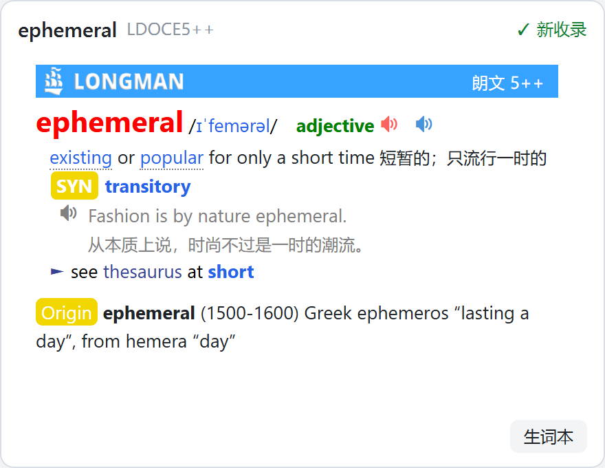
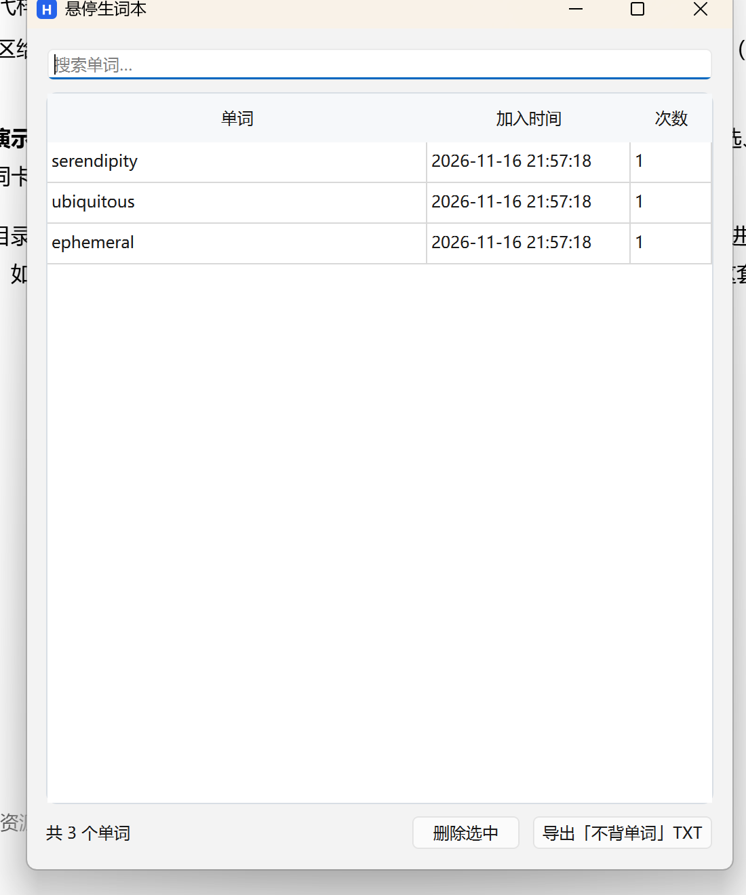

# HoverDict

Hover over an English word on screen for half a second: a popup shows its definition from your **local MDX dictionaries**, and the word is silently added to a **wordbook** that exports to plain TXT — ready to import into vocabulary apps such as 不背单词 (bbdc.cn), Anki or 墨墨.

Fully offline: no network calls, no cloud OCR, no translation API. It uses the OCR engine that ships with Windows plus the MDX dictionaries you already own.


| Same popup, LDOCE5++ dictionary | Wordbook |
| --- | --- |
|  |  |

> 中文说明见 [README.md](README.md)。

## How it works

```
cursor ──(rests 450 ms)──> grab screen region ──> Windows.Media.Ocr ──> word under the cursor
                                                                          │
                                                    ┌─────────────────────┤
                                                    ▼                     ▼
                                         look up local MDX       write to SQLite wordbook
                                         (lazy decompress +      (dedupe, counts,
                                          8-block LRU cache)      export flags)
                                                    │
                                                    ▼
                                  QWebEngineView popup (setHtml + CSS inlined from MDD)
```

Everything is local: `mdxlib.py` parses MDX/MDD itself (2.0 and 3.0 layouts, `@@@LINK=` redirects, case-insensitive lookup), `ocr.py` drives `Windows.Media.Ocr` through `winsdk`, `store.py` is a tiny SQLite layer, and `ui.py` renders the dictionary entry exactly as its stylesheet in the MDD intends.

## Features

- **Hover to look up** — no selection, no hotkey. Works in browsers, PDF readers, Word, Kindle and even screenshots, because it reads pixels instead of the accessibility tree.
- **Original dictionary typography** — CSS, images and fonts are read from the `.mdd` pack, so Collins / LDOCE5++ / Oxford entries look like the real thing.
- **Multi-dictionary fallback** — dictionaries are queried in the order you configure; if the first one lacks an inflected form (`users`, `apples`), the next one answers.
- **Automatic wordbook** — SQLite storage, duplicate hovers only bump a counter; searchable, deletable, exportable.
- **Noise filtering** — words shorter than 3 letters, all-caps abbreviations, and ~200 high-frequency function words are ignored; holding the left button (dragging a selection) never triggers.
- **Daily export that never repeats** — one `hoverdict-YYYY-MM-DD.txt` per day; exported words are flagged, and words added later to an already-exported day are *appended* instead of creating a `(1)` copy.
- **Lives in the tray** — `Ctrl+Alt+H` opens the wordbook; clicking the shortcut again while it runs just brings the window forward.

## Requirements

- Windows 10 1809+ / Windows 11
- Python **3.12** (3.13+ may lack a `winsdk` wheel)
- The English (US) OCR language pack:
  *Settings → Time & language → Language & region → Add a language “English (United States)” → Language options → Optical character recognition*
- Your own MDX dictionaries — **this repository ships no dictionary data** (see [Dictionary licensing](#dictionary-licensing))

## Install (from source)

```bat
git clone https://github.com/<your-name>/hoverdict.git
cd hoverdict
setup.bat
```

`setup.bat` creates `.venv` and installs PySide6, winsdk, mdict-utils, mss and Pillow.

Then copy `config.example.json` to `data\config.json` and point `dict_dir` at the folder containing your `.mdx` files:

```json
{
  "dict_dir": "D:/Dicts/eudic",
  "dicts": ["Collins COBUILD Advanced Learner's Dictionary", "LDOCE5++ V 1-35"],
  "dict_labels": {
    "Collins COBUILD Advanced Learner's Dictionary": "Collins",
    "LDOCE5++ V 1-35": "LDOCE5++"
  }
}
```

- **Every `.mdx` inside `dict_dir` becomes a dictionary**; a same-named `.mdd` (styles, images, audio) is picked up automatically.
- `dicts` is the lookup priority (file name without `.mdx`); leave it empty to use everything in file-name order.
- `dict_labels` is optional and only shortens the name shown in the popup title.

Run it:

```bat
start_hoverdict.bat      :: background, no console window
run.bat                  :: with a console, for debugging
```

The wordbook window pops up on start-up; closing it does not stop the background hover detection.

### Prebuilt executable

```powershell
powershell -ExecutionPolicy Bypass -File build_exe.ps1
```

Produces `dist\HoverDict\HoverDict.exe` (one-folder build). On first run it creates `data\` next to the exe; edit `data\config.json` the same way. Prebuilt archives are also attached to GitHub releases by `.github/workflows/build.yml` when a `v*` tag is pushed.

### Autostart & desktop shortcut (optional)

```powershell
$exe = "$PWD\.venv\Scripts\pythonw.exe"
$arg = """$PWD\main.py"""
New-ItemProperty -Path "HKCU:\Software\Microsoft\Windows\CurrentVersion\Run" -Name HoverDict `
  -Value "$exe $arg" -PropertyType String -Force
```

For the desktop shortcut, point it at `cmd.exe /c "<path>\start_hoverdict.bat"` rather than `pythonw.exe` directly: going through the signed `cmd.exe` avoids the SmartScreen “unrecognized app” prompt for unsigned Python launchers. Use `assets\hoverdict.ico` as the icon.

## Usage

What happens on hover:

1. the cursor stays still for `dwell_ms` (default 450 ms), no left button held, not over the app's own popup;
2. a small screen region around the cursor is captured, OCR'd, and the word under the cursor is picked;
3. the dictionaries are queried in order — the first hit opens a popup below-right of the cursor (flipping to the other side when it would leave the screen);
4. the word is written to the wordbook; hovering it again only increments the counter;
5. the popup disappears once the cursor moves ~90 px away.

Tray menu:

| Item | What it does |
| --- | --- |
| Open wordbook… | search / delete / export |
| Pause hover lookup | temporarily stop triggering (already saved words stay) |
| Merge-export pending words… | one TXT with every word not exported yet |
| Daily export… | one TXT per day, never writing a word twice |
| Open export folder | opens `export_dir` in Explorer |
| Quit | exits |

Hotkey: `Ctrl + Alt + H` opens the wordbook.

## Exporting to a vocabulary app

Two buttons at the bottom of the wordbook window (also in the tray menu):

- **Merge-export pending words…** — every word not exported yet goes into one TXT; handy when you need ≥20 words before uploading.
- **Daily export…** — writes `hoverdict-YYYY-MM-DD.txt` per *date added*:
  - each date is written once; exported words are flagged and never repeated;
  - words added later to the same day are **appended**, so no `(1)`, `(2)` copies appear;
  - every 30 minutes (and at start-up) the app exports **finished days** into `export_dir`; **today's words are not auto-exported**, so a day is never split into partial files.

Format: UTF-8, no BOM, one lowercase English word per line, no definitions/timestamps.

Importing into 不背单词 (bbdc.cn):

1. sign in at <https://www.bbdc.cn> in a browser;
2. **☰ → 自定义词书 / custom wordbook**;
3. upload the TXT — definitions and examples are matched automatically;
4. failed words are highlighted for manual fixing; **at least 20 recognised words** are required, max 5000 per upload;
5. save & sync, then the book appears in the app under *Dashboard → Wordbooks → My custom books*.

## Configuration

`data/config.json`:

| Key | Default | Meaning |
| --- | --- | --- |
| `enabled` | `true` | enable/disable hover lookup |
| `dwell_ms` | `450` | how long the cursor must rest |
| `dict_dir` | `""` | folder with `.mdx` files; empty = auto-detect `%HOVERDICT_DICTS%` then `D:\Dicts\eudic` |
| `dicts` | `[]` | lookup priority, by MDX file name without extension |
| `dict_labels` | `{}` | optional short names for the popup title |
| `export_dir` | `<app dir>/exports` | where daily exports are written |
| `auto_export` | `true` | auto-export finished days |
| `show_wordbook_on_start` | `true` | open the wordbook window at start-up |
| `show_tip_on_start` | `true` | show a tray balloon at start-up |
| `debug` | `false` | also log successful lookups |

`data/hover.log` is JSONL; every miss is logged with `reason: no-word` or `no-entry`, which is the fastest way to find out why some word never triggers a popup.

## Limitations

- **It reads pixels**: covered windows, text smaller than ~10 px, some exclusive-fullscreen games and certain Remote Desktop sessions will not work.
- English words only (letters plus `'` and `-`); **multi-word phrases are not supported**, and CJK text never triggers.
- Inflected forms are looked up literally — pair a lemma-rich dictionary (LDOCE5++ works well) so `users`/`apples` still resolve.
- The popup cannot be pinned; for long entries use the wordbook or your dictionary app.
- On multi-monitor setups with mixed scaling the popup may be slightly off.

## Troubleshooting

**Double-clicking does nothing?** It is already running in the background — a second click just brings the wordbook forward. On Windows 11 the tray icon may be hidden behind the `^` overflow chevron.

**“Cannot write to this folder”?** Some Windows security policies forbid ordinary processes from writing to Desktop/Documents. The app falls back to its own `exports` folder and offers *Open folder* / *Copy to Desktop*; the copy is delegated to Explorer, which usually succeeds.

**Export said it worked but the Desktop has no file?** Check the path shown in the dialog (there is an *Open folder* button), and note that a day with no new words produces no file.

**SmartScreen blue screen?** Launching an unsigned `pythonw.exe` directly triggers it. Use `start_hoverdict.bat` (goes through `cmd.exe`) or the autostart entry described above.

**The exe says `Failed to load Python DLL ... python312.dll`?** The build is fine — the *location* is the problem. Some managed or redirected folders (corporate sandbox directories, certain sync or virtual drives) block the PyInstaller loader from loading its DLLs. Move the whole `HoverDict` folder to a plain local directory (e.g. `C:\HoverDict`) and start it there.

## Dictionary licensing

This repository contains **no dictionary data**. The app only reads MDX files that already exist on your machine; dictionary content remains the property of its publishers — obtain it legally. MDX parsing follows the publicly documented format also implemented by [mdict-utils](https://github.com/liuyug/mdict-utils).

## License

[MIT](LICENSE)
