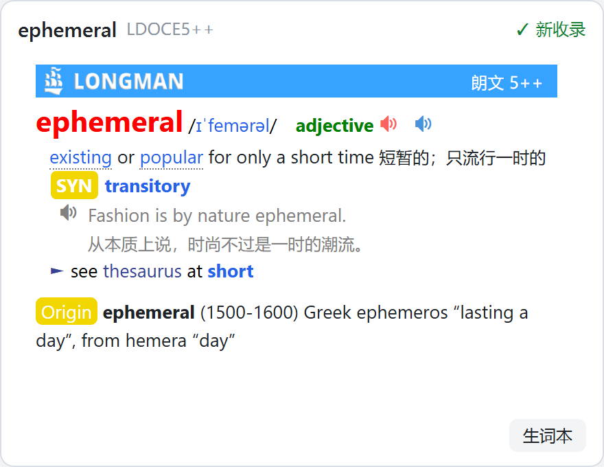
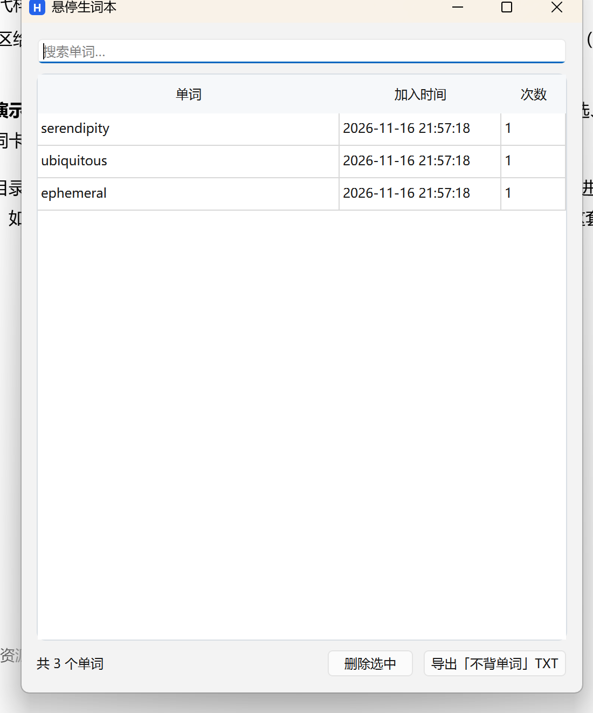

# HoverDict · 悬停查词 + 自动生词本

> 把鼠标停在一个英文单词上 0.5 秒 → 弹出本地词典里的释义，并自动收录进生词本；生词本可导出成「不背单词」等 App 能直接导入的 TXT。
>
> Hover an English word on screen for half a second: a popup shows its definition from your **local MDX dictionaries**, and the word is added to a **wordbook** that exports to plain TXT (one word per line) for apps like 不背单词 / Anki / 墨墨.

全部离线：不联网、不调用任何翻译或 OCR 云服务，只用 Windows 自带的 OCR 引擎 + 你自己的 MDX 词库。

**English:** [README.en.md](README.en.md)


| 换了 LDOCE5++ 词库 | 生词本 |
| --- | --- |
|  |  |

## 特性

- **悬停即查**：不用选中、不用快捷键，鼠标停住 450ms 就触发；取词靠屏幕 OCR，所以在浏览器、PDF 阅读器、Word、Kindle、截图里都能用。**鼠标离开那个单词，浮窗自动消失**（移到浮窗本身上则保持不动，方便读完再走）。
- **本地词典原版排版**：直接读 `.mdx` / `.mdd`，CSS、图片、字体从 MDD 里取，浮窗里就是词典原本的样子（柯林斯、LDOCE5++、牛津、剑桥都验证过）。
- **多词典回退**：按配置顺序查，前一本查不到自动换下一本（比如柯林斯没有 `users` 这种屈折形，LDOCE5++ 有）。
- **自动生词本**：SQLite 存储，重复悬停只加「次数」，带搜索、导出；**右键任意单词可单独删除**，也可以选中后按 `Delete`。
- **防噪音**：少于 3 个字母、纯大写缩写、约 200 个高频虚词不收录；按住左键拖选时不触发。
- **按日导出、绝不重复**：一天一个 `hoverdict-YYYY-MM-DD.txt`，导出过的词打标记，同一天补录的新词追加到当天文件末尾。
- **一眼看出在不在跑**：生词本顶部有状态灯 + 「启用悬停查词」开关——绿点「正在运行」，点掉变灰点「已暂停」，暂停后既不查词也不记生词。
- **常驻后台**：托盘图标 + `Ctrl+Alt+H` 呼出生词本；程序已在跑时再点一次快捷方式只会把窗口叫到前台。

| 运行中 | 已暂停 |
| --- | --- |
|  |  |

## 环境要求

- Windows 10 1809+ / Windows 11
- Python **3.12**（3.13+ 上 `winsdk` 轮子可能装不上）
- 系统装有 **英语(美国) 的 OCR 语言包**：
  `设置 → 时间和语言 → 语言和区域 → 添加语言「English (United States)」→ 语言选项 → 光学字符识别`
- 你自己的 MDX 词库（本仓库**不附带任何词典**，见下文）

## 安装

```bat
git clone https://github.com/<your-name>/hoverdict.git
cd hoverdict
setup.bat
```

`setup.bat` 会建 `.venv` 并安装依赖（PySide6、winsdk、mdict-utils、mss、Pillow）。

然后配置词库位置：把 `config.example.json` 复制成 `data\config.json`，把 `dict_dir` 改成你放 `.mdx` 的文件夹：

```json
{
  "dict_dir": "D:/Dicts/eudic",
  "dicts": ["柯林斯高阶英汉双解学习词典（好看）", "LDOCE5++ V 1-35"],
  "dict_labels": {
    "柯林斯高阶英汉双解学习词典（好看）": "柯林斯",
    "LDOCE5++ V 1-35": "LDOCE5++"
  }
}
```

- `dict_dir` 里**每个 `.mdx` 都会成为一部可用词典**，同名的 `.mdd`（放 CSS/图片/发音）会被自动带上。
- `dicts` 是查词优先级（写文件名去掉 `.mdx` 的那部分），留空 = 全部可用、按文件名排序。
- `dict_labels` 可选，用来给浮窗标题起短名字。

启动：

```bat
start_hoverdict.bat      :: 后台运行（无黑框）
run.bat                  :: 带控制台，方便看报错
```

启动后会自动弹出「悬停生词本」窗口。关掉它不影响后台取词。

### 开机自启 & 桌面快捷方式（可选）

```powershell
# 开机自启
$exe = "$PWD\.venv\Scripts\pythonw.exe"
$arg = """$PWD\main.py"""
New-ItemProperty -Path "HKCU:\Software\Microsoft\Windows\CurrentVersion\Run" -Name HoverDict `
  -Value "$exe $arg" -PropertyType String -Force
```

桌面快捷方式建议指向 `cmd.exe /c "<路径>\start_hoverdict.bat"`（用 `cmd.exe` 而不是直接指 `pythonw.exe`，可以避开 Windows 对未签名程序的 SmartScreen 提示），图标用 `assets\hoverdict.ico`。

### 打包成 exe（给没装 Python 的电脑用）

```powershell
powershell -ExecutionPolicy Bypass -File build_exe.ps1
```

或者直接双击 `build_exe.bat`。产物是 `dist\HoverDict\HoverDict.exe`（one-folder 模式，整个 `dist\HoverDict` 文件夹一起拷走即可）。

- 首次运行会在 exe 旁边生成 `data\config.json`，和源码版一样改 `dict_dir`；
- 打出来的包**不含 Python 环境**，目标机器不需要装 Python，但仍需要英语 OCR 语言包；
- 体积约 **600 MB**（QtWebEngine 本身就占大头），zip 后约 200 MB；
- 打包用的是 `hoverdict.spec`（已处理 PySide6 QtWebEngine 的 `QtWebEngineProcess.exe` 与 winsdk 的动态 WinRT 投影），不要用 `pyinstaller main.py` 直接打，会缺文件。

推 `v*` 标签时，`.github/workflows/build.yml` 会自动在 GitHub 的 windows runner 上构建并附到 Release：

```bash
git tag v1.0.0 && git push origin v1.0.0
```

## 使用

悬停时发生什么：

1. 鼠标停住 `dwell_ms`（默认 450ms），且没有按住左键、没有停在自己的浮窗上；
2. 截取光标周围一块屏幕 → Windows OCR → 取落在光标下的那个词；
3. 按顺序查词库，命中就弹出浮窗（光标右下方，放不下自动翻到左边/上边）；
4. 同一个词写进生词本；重复悬停只把「次数」+1；
5. 鼠标移开约 90px 后浮窗自动消失。

托盘菜单：

| 菜单项 | 作用 |
| --- | --- |
| 打生词本… | 打开生词本（搜索 / 删除 / 导出） |
| 暂停悬停取词 | 临时关掉触发（不影响已收录的词） |
| 合并导出待导出词… | 把所有**还没导出过**的词合成一个 TXT |
| 按日导出… | 一天一个 TXT，已导出的词不会重复写 |
| 打开导出文件夹 | 在资源管理器里打开 `export_dir` |
| 退出 | 结束程序 |

快捷键：`Ctrl + Alt + H` 呼出生词本。

## 导出到「不背单词」

生词本窗口底部（托盘里也有）两个按钮：

- **合并导出待导出…** —— 所有未导出的词写进一个 TXT，适合攒够 20 个再传。
- **按日导出…** —— 按「加入日期」各写一个 `hoverdict-YYYY-MM-DD.txt`：
  - 每个日期只写一次，导出过的词打标记，之后永不重复；
  - 同一天后来补录的新词**追加**到当天文件末尾，不会生成 `(1)(2)` 副本；
  - 程序每 30 分钟 + 每次启动检查一次，把**已经过完的日期**自动导出到 `export_dir`；**今天的词不自动导出**，避免一天被切成多个不完整文件。

导出格式：UTF-8、无 BOM、每行一个**小写英文单词**，不含释义/时间/分组。

导入不背单词：

1. 浏览器打开 <https://www.bbdc.cn> 登录；
2. 右上角 **☰ → 自定义词书**（部分版本叫「自制词书」）；
3. 上传 TXT，系统自动匹配释义和例句；
4. 识别失败的词会标红，手动改正；**识别成功需 ≥ 20 个词**，单次最多 5000 词；
5. 保存并同步，30 秒内 App 里 **仪表盘 → 词书 → 我的自制** 可见。

## 配置项

`data/config.json`：

| 字段 | 默认 | 说明 |
| --- | --- | --- |
| `enabled` | `true` | 是否启用悬停取词 |
| `dwell_ms` | `450` | 停留多久触发，调大更抗误触 |
| `dict_dir` | `""` | MDX 所在文件夹；空 = 自动找 `%HOVERDICT_DICTS%`、`D:\Dicts\eudic` |
| `dicts` | `[]` | 查词优先级，文件名去掉 `.mdx` |
| `dict_labels` | `{}` | 选填，给词典起短名 |
| `export_dir` | `<程序目录>/exports` | 按日导出的目标文件夹 |
| `auto_export` | `true` | 是否自动导出「已过完的日期」 |
| `show_wordbook_on_start` | `true` | 启动时是否弹出生词本窗口 |
| `show_tip_on_start` | `true` | 启动时是否弹托盘提示 |
| `debug` | `false` | `true` 时把每次命中也写进 `data/hover.log` |

`data/hover.log` 是 JSONL：每次没识别到词都会记一条（`reason: no-word / no-entry`），排查「为什么某些词不弹窗」时看这个。

## 工作原理

```
鼠标位置 ──(450ms 停住)──> mss 截屏(光标附近) ──> Windows.Media.Ocr ──> 落在光标下的词
                                                                          │
                                                    ┌─────────────────────┤
                                                    ▼                     ▼
                                          mdxlib 查 MDX 词库        store 写 SQLite
                                          （按需解压 + LRU）         （生词本、导出标记）
                                                    │
                                                    ▼
                                  QWebEngineView 浮窗（setHtml + 内联 MDD 里的 CSS）
```

- **mdxlib.py**：自己实现的 MDX/MDD 读取器。打开时只建词头索引 + 记录每个记录块的偏移，查词时才解压对应块（8 块 LRU）。13 部词典（含 200MB 的 LDOCE）打开 0.5s、查词 <1ms。支持 MDX 2.0/3.0 两种块布局、`@@@LINK=` 跳转、大小写不敏感。
- **ocr.py**：`mss` 截屏 → BGRA → `SoftwareBitmap` → `OcrEngine.recognize_async`。取词用「点落在词矩形内 / 距离最近」判定，并按三档逐步放大裁切区域重试（词被窗口边缘截断时能救回来）。
- **store.py**：`words(word PK, added_at, count, source, brief, last_seen, exported_at, exported_day)`，导出即写标记。
- **ui.py**：浮窗（无边框、置顶、跟随光标）、生词本窗口、托盘、`dict://` 自定义协议（页面里的图片/字体从 MDD 读）。

## 项目结构

| 文件 | 作用 |
| --- | --- |
| `main.py` | 入口：托盘、悬停检测、收录与导出调度 |
| `ui.py` | 浮窗 / 生词本窗口 / 托盘 / `dict://` 资源协议 |
| `ocr.py` | 截屏 + Windows OCR + 落点取词 + 停用词过滤 |
| `mdxlib.py` | MDX/MDD 解析（按需解压 + LRU 缓存） |
| `dicts.py` | 词库发现（扫描 `dict_dir`）与 `Dictionary` 封装 |
| `store.py` | 生词本 SQLite + 按日 / 合并导出 |
| `hoverdict.spec` | PyInstaller 打包配置 |
| `build_exe.ps1` `build_exe.bat` | 一键打包 exe |
| `setup.bat` | 建 `.venv` 装依赖 |
| `start_hoverdict.bat` `run.bat` | 启动（后台 / 带控制台调试） |
| `.github/workflows/build.yml` | 打 `v*` 标签自动构建 exe 并发布 Release |
| `assets/hoverdict.ico` | 应用图标 |

## 已知限制
- **认的是屏幕像素**：窗口被遮挡、字号 < 10px、部分独占全屏游戏、某些远程桌面会话里可能取不到词。
- 只认英文单词（含 `'` `-`），**不支持带空格的词组**；中文/日文不触发。
- 词形按词典原样查：有些词典没有 `users`/`apples` 这类屈折形，配一部收词全的词典（如 LDOCE5++）即可回退命中。
- 浮窗不做「钉住」；要看长条目请打开生词本或原词典。
- 高 DPI 多屏下浮窗位置按主屏缩放换算，混合缩放的极端排列可能偏一点。

## 常见问题

**双击没反应 / 没窗口？**
程序已经在后台跑了 —— 再点一次快捷方式只会把生词本叫到前台。托盘图标可能被 Win11 收进 `^` 溢出区，拖出来即可。

**导出时提示「这个文件夹写不进去」？**
部分 Windows 安全策略（或企业管控）不允许普通进程往桌面/文档写文件。程序会自动改用自带 `exports` 文件夹，并给你「打开文件夹」和「复制到桌面」两个按钮；「复制到桌面」是让资源管理器代劳，通常都能成。

**点了导出但桌面没有文件？**
看弹窗里给出的路径 —— 有「打开文件夹」按钮直接定位；也可能是当天没有新词（已导出过的不再重复写）。

**SmartScreen 蓝屏警告？**
直接用 `pythonw.exe` 起未签名程序会触发。用仓库里的 `start_hoverdict.bat`（经 `cmd.exe`）或按上面「开机自启」的方式启动就不会再弹。

**exe 版报 `Failed to load Python DLL ... python312.dll`？**
打包本身没问题，是**存放位置**的问题：某些受管控 / 被重定向的目录（公司沙箱目录、部分同步盘、虚拟盘）会拦住启动器加载 DLL。把整个 `HoverDict` 文件夹移动到普通本地目录（如 `C:\HoverDict`、`D:\Tools\HoverDict`）再运行即可。

## 词库版权

本仓库**不包含任何词典数据**。程序只是读取你本机已有的 MDX 文件；词典内容的版权归各出版方所有，请自行合法获取。MDX 格式解析参考了 [mdict-utils](https://github.com/liuyug/mdict-utils) 的公开实现。

## License

本项目的代码以 [MIT](LICENSE) 发布。

预编译的 exe 里还打包了 Qt / PySide6（**LGPL-3.0**）、Qt WebEngine（含 Chromium）、winsdk、mdict-utils、mss、Pillow 等第三方组件，它们的许可证见 [THIRD-PARTY-NOTICES.md](THIRD-PARTY-NOTICES.md)。如果你分发自己构建的 exe，请把这份声明和 Qt 的 LGPL 文本一起带上，并保持 `_internal\PySide6\*.dll` 可替换（onedir 构建默认满足；不要用 one-file 把 Qt 藏进自解压包里）。
